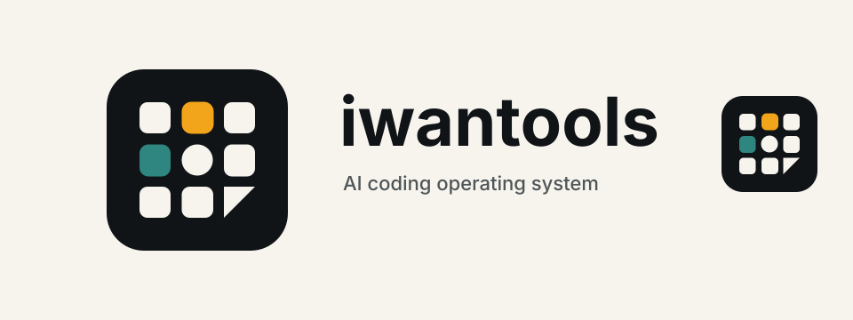

  

  <strong>商业 Admin 基座「Iwan Admin」的开发与交付</strong> 
  客户基于基座开发自己的业务，通过 Git 共同历史持续接收功能更新与缺陷修复

  <a href="https://iwantools.com/"><strong>官网 · 爱玩工具站</strong></a>
  ·
  <a href="https://github.com/iwantools/create-iwantools"><strong>脚手架</strong></a>

  
  
  

## 我们做什么

不是外包，也不是 SaaS——我们交付一套**可长期演进的工程基座**：

- **一次搭建**：完整 IAM、系统管理、动态菜单、监控与部署件，直接开始业务开发
- **持续升级**：基座缺陷与通用能力由官方持续发行，客户经 Git 三方合并平滑接收，业务与数据完整保留
- **客户自主**：付费源码 + 部署包，源码、数据、凭证与部署环境全归客户

**基座开发 → 独立业务使用 → 通用修复发布 → 业务接收升级**

## 仓库导航

| 仓库 | 说明 |
| --- | --- |
| [`create-iwantools`](https://github.com/iwantools/create-iwantools) | 工作空间脚手架（公开）：`npx github:iwantools/create-iwantools` 一键搭建 |
| [`iwan-admin`](https://github.com/iwantools/iwan-admin) | Iwan Admin 官方基座（私有，付费交付） |
| [`iwantools-site-ops`](https://github.com/iwantools/iwantools-site-ops) | 首个客户工程：爱玩工具站运营后台（私有） |
| [`ai-skills`](https://github.com/iwantools/ai-skills) | 组织 AI Coding Skills 源码仓（私有） |
| `.github` | 本仓库：组织主页 Profile |

## 合作方式

提供付费源码与部署包，帮助客户快速启动业务、验证 MVP，并提供一定的使用指导。详见官网。
